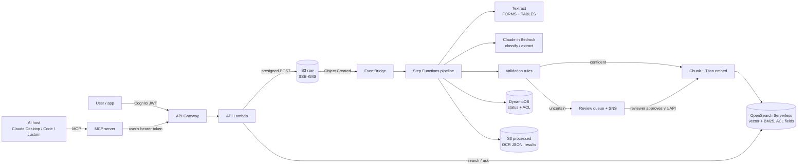

# Intelligent Document Processing on AWS

Extraction, classification, validation, and retrieval for contracts, invoices, audit evidence, and
compliance records, built with **Amazon Textract**, **Claude in Amazon Bedrock**, and **Amazon OpenSearch
Serverless**. It exposes a **REST API** for applications and an **MCP server** so AI assistants (Claude
Desktop, Claude Code, or the custom host in this repo) can search and review documents under the same
access controls as people.

The idea behind the design: extraction, interpretation, validation, retrieval, and human review are
separate steps, and each one makes its errors visible. A readable summary isn't enough. Every extracted
value has to be traceable to a quote in the source, pass business rules, and go to a person when the
system is unsure.



## What it does

| Stage | Component | Output |
|---|---|---|
| Intake | API → presigned POST (size/type enforced by S3) → S3 (KMS) | Registered document with owner, tenant, allowed groups |
| OCR | Textract async `StartDocumentAnalysis` (FORMS, TABLES) | Lines, key-value pairs, tables, each with a confidence score |
| Classify | Claude, low effort, closed set of types | `contract` / `invoice` / `audit_evidence` / `compliance_record` / `other` + confidence |
| Extract | Claude, per-type schema returned through a result tool, then validated against the JSON schema | Each field has a value, a verbatim **evidence** quote, a page, and a confidence |
| Ground | Deterministic check | Is the evidence actually in the OCR text, and does it contain the value? |
| Validate | Business rules | Missing required fields, low confidence on critical fields, totals ≠ subtotal + tax, date order, failed controls, prompt-injection markers, poor scans |
| Route | Step Functions `Choice` | Auto-approve → index, or **human review** with stated reasons |
| Review | `POST /documents/{id}/review` (reviewer role, not the uploader) | Corrections recorded with reviewer ID; append-only audit record |
| Retrieve | OpenSearch k-NN + BM25 merged with reciprocal rank fusion; ACL filter inside the query | Search hits and cited answers, limited to documents the caller may read |

## Repository layout

```
src/idp/
  adapters/      Textract, Claude (Bedrock), Titan embeddings, OpenSearch, DynamoDB/S3 (plus in-memory fakes)
  pipeline/      classify, extract (+ grounding), validate, index (chunking), answer (RAG)
  handlers/      Step Functions task Lambdas
  api/           REST API Lambda (Powertools router)
  security/      authorization (tenant, groups, segregation of duties), log redaction
  mcp_server/    MCP server: tools, resources, prompts; stdio + streamable HTTP
  host/          a minimal MCP host: Claude + MCP client + human approval gate
  eval/          field-level precision/recall, review rate, escaped-error rate, effort reduction
  local.py       offline mode: fake Textract, rule-based stand-in model, in-memory stores
infra/           AWS CDK (Python): KMS, S3, DynamoDB, Lambda, Step Functions, AOSS, API GW, Cognito, alarms
tests/           47 tests: parser, validation, API end to end, ACLs, MCP client↔server, host loop, AWS adapters (moto)
docs/            architecture, MCP deep dive, API reference, evaluation method, ADRs, interview prep
samples/         four sample documents (clean invoice, suspicious invoice, MSA, audit evidence)
```

## Quick start (no AWS account needed)

```bash
python3.12 -m venv .venv && source .venv/bin/activate
pip install -e ".[dev]"
make test        # 47 tests
make demo        # register -> pipeline -> review -> approve -> index -> search -> ask, all in memory
```

The offline mode swaps AWS services for in-memory versions and replaces Claude with a rule-based stand-in
that only understands the `Label: value` sample files. It exercises the plumbing, the rules, and the
access control. **It says nothing about extraction accuracy**. Accuracy has to be measured against
Claude on real documents (see [docs/EVALUATION.md](docs/EVALUATION.md)).

## Deploy to AWS

Prerequisites: AWS credentials, Node.js (for the CDK CLI), Docker (for bundling Lambda dependencies), and
access to Claude in Amazon Bedrock enabled for your account and region.

```bash
pip install -r infra/requirements.txt
cd infra
npx cdk bootstrap
npx cdk deploy -c model_id=anthropic.claude-opus-5-5 -c alarm_email=you@example.com
```

After deploy, create users in the Cognito pool, set the immutable `custom:tenant_id` attribute, and add
users to groups (`finance`, `legal`, `compliance`, `audit`, `reviewers`, `admins`). Before production,
also: scope the `bedrock-mantle:CreateInference` permission to your model ARNs, move OpenSearch
Serverless to a VPC endpoint, and replace `allowed_origins=["*"]` on the upload bucket with your web origin.

## REST API

| Method | Path | Who | Purpose |
|---|---|---|---|
| `POST` | `/documents` | any user | Register a document, get a presigned POST (PDF/PNG/JPEG/TIFF, ≤ 50 MB) |
| `GET` | `/documents` | any user | List documents you can read (`?status=`) |
| `GET` | `/documents/{id}` | readers | Status, type, summary, review reasons |
| `GET` | `/documents/{id}/fields` | readers | Fields with evidence, confidence, validation issues |
| `POST` | `/search` | any user | Hybrid search over documents you can read |
| `POST` | `/ask` | any user | Cited answer from retrieved excerpts |
| `GET` | `/reviews` | reviewers | Review queue |
| `POST` | `/documents/{id}/review` | reviewers (not the uploader) | Approve or reject, with corrections |

Details and examples: [docs/API.md](docs/API.md).

## MCP server

```bash
export IDP_API_URL=https://<api-id>.execute-api.<region>.amazonaws.com/v1
export IDP_API_TOKEN=<Cognito ID token>
idp-mcp                                   # stdio, for Claude Desktop / Claude Code
MCP_TRANSPORT=streamable-http idp-mcp     # remote, stateless HTTP behind a load balancer
idp-host                                  # the terminal host in this repo (Claude on Bedrock + this server)
```

| Primitive | Name | Notes |
|---|---|---|
| Tool | `search_documents`, `ask_documents`, `get_document`, `get_extracted_fields`, `list_review_queue` | `read_only_hint=true` |
| Tool | `submit_review` | `destructive_hint=true`; asks the human via **elicitation** before it runs |
| Resource | `idp://documents/{document_id}`, `idp://schemas/{doc_type}` | Context the host can attach |
| Prompt | `contract_risk_review`, `invoice_exception_triage` | User-invoked workflows |

The MCP server has **no AWS credentials and no direct data access**. It calls the REST API with the user's
own token, so an AI assistant can never see more than that user can. Full explanation of hosts, clients,
servers, transports, and security: [docs/MCP.md](docs/MCP.md).

Claude Code: `claude mcp add idp --env IDP_API_URL=... --env IDP_API_TOKEN=... -- idp-mcp`.
Claude Desktop: see [docs/mcp/claude_desktop_config.json](docs/mcp/claude_desktop_config.json).

## Security controls (implemented)

- **AuthN**: Cognito user pool (MFA required, no self sign-up); API Gateway verifies the JWT.
- **AuthZ in code, not prompts**: tenant isolation plus group ACLs on every read. The same filter is applied
  *inside* every OpenSearch query (k-NN efficient filtering), so unauthorized chunks are never retrieved.
  Requests for other tenants' documents return 404, not 403, so IDs can't be probed.
- **Segregation of duties**: reviewers can't approve documents they uploaded.
- **Prompt injection**: document text is fenced and labeled untrusted; the pipeline model has no
  tools that act on anything; outputs are schema-validated, grounded, and rule-checked; instruction-like text
  is flagged for review; MCP write actions need human confirmation and the API re-checks the role.
- **Encryption**: one customer-managed KMS key (rotation on) for S3, DynamoDB, SNS, SQS, Lambda env,
  and OpenSearch Serverless; TLS enforced on buckets.
- **Least privilege**: one IAM role per Lambda, each with only its own actions.
- **Logging hygiene**: no document content in logs or Step Functions history (state carries IDs and S3
  keys only); error causes redacted; SNS messages carry IDs and reason codes only.
- **Retention**: lifecycle expiry on raw documents; versioning; PITR on DynamoDB; access logs.
- **Audit**: reviewer decisions are written as append-only records; CloudTrail covers Bedrock and Textract calls.

## Status and honesty notes

This repository is a **reference implementation** that runs and is tested offline, and the CDK stack
synthesizes. Deploying it and measuring accuracy on real documents are separate steps. Don't present
numbers from the offline demo as production results. The interview guide in
[docs/INTERVIEW_PREP.md](docs/INTERVIEW_PREP.md) covers how to talk about scope and metrics accurately.

## License

MIT
