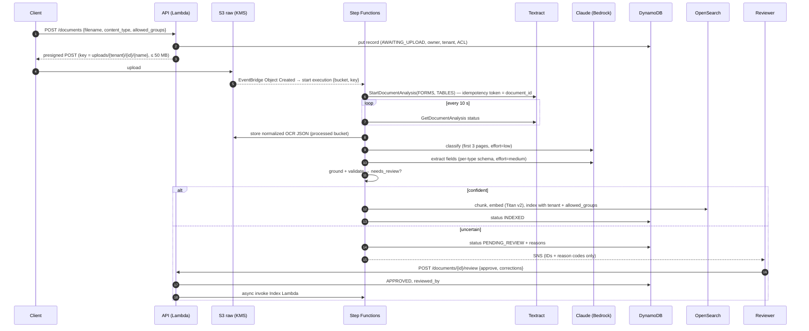
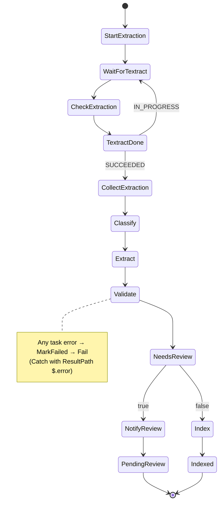

# Architecture

## 1. Responsibilities

| Concern | Owner | Why it's separate |
|---|---|---|
| Turning pixels into text, with confidence | **Textract** | Purpose-built OCR with layout (forms, tables) and per-word confidence. The LLM never has to read pixels. |
| Deciding what a document is and what its fields mean | **Claude in Bedrock** | Layouts vary across vendors and contract templates; rules and templates don't generalize, a language model does. |
| Deciding whether the result is trustworthy | **Deterministic code** | Grounding checks, business rules, and thresholds are testable and explainable. The model doesn't grade itself. |
| Finding relevant content later | **OpenSearch Serverless** | Vector search finds paraphrases, BM25 finds exact IDs ("INV-2026-0417"). The ACL filter runs inside the query. |
| Final say on uncertain cases | **A human reviewer** | Routed with explicit reasons, corrections recorded, uploader can't approve their own document. |

## 2. End-to-end sequence



## 3. State machine



**Design choices**

- **The state carries only IDs and S3 keys.** Step Functions payloads are capped at 256 KB, and execution
  history is visible to anyone with `states:GetExecutionHistory`. Document text never sits there.
- **Retries vs. review.** Throttling (`RetryableLLMError`, Textract `ThrottlingException`) is retried with
  exponential backoff and full jitter. Model outcomes that won't improve on retry (refusal, truncation,
  invalid schema) become `LLMError`, and the document goes to **review** instead of failing.
- **Polling vs. callback.** Textract can publish completion to SNS, so a `.waitForTaskToken` callback would
  avoid polling. A 10 s Wait loop is simpler and cheap at this volume. The callback is the change to make at
  scale (see ADR 0001).
- **Idempotency.** Textract `ClientRequestToken = document_id`, so a retried start doesn't create a second
  job. Indexing deletes a document's chunks before writing, so re-indexing after a correction replaces rather
  than duplicates. Registration uses a DynamoDB conditional put.
- **Uploads can't bypass registration.** `StartExtraction` rejects any object whose key doesn't match a
  registered record.

## 4. Data model

**DynamoDB `Documents`** (PK `document_id`, GSI `tenant-status`): owner, tenant_id, allowed_groups,
filename, content_type, s3_key, status, doc_type, classification_confidence, summary, extraction_key,
result_key, review_reasons, reviewed_by, error, timestamps.

**S3 processed**: `extracted/{id}.json` (normalized Textract output), `results/{id}.json` (fields,
issues, summary), `reviews/{id}/{timestamp}.json` (append-only reviewer decisions).

**OpenSearch index `idp-chunks`**: chunk_id, document_id, tenant_id, allowed_groups, doc_type, page,
text, embedding (`knn_vector`, 1024 dims, HNSW/faiss, inner product on normalized Titan vectors).

Statuses: `AWAITING_UPLOAD → PROCESSING → (PENDING_REVIEW → APPROVED | REJECTED) | APPROVED → INDEXED`,
or `FAILED`.

## 5. Extraction and confidence

Each field returned by Claude includes `value`, `evidence` (verbatim quote), `page`, and the model's own
`confidence`. The system doesn't trust that number on its own:

```
combined = model_confidence × min(1, OCR_confidence_of_the_source_line / 100) × (0.5 if not grounded)
```

- **Grounded** means the normalized evidence appears in the OCR text, and the value's tokens appear in the
  evidence. A value with no supporting quote, or one that doesn't match its quote, is treated as unverified.
- **Critical fields** (invoice total, contract dates, control result) must be above
  `MIN_FIELD_CONFIDENCE` (default 0.85) or the document goes to review.
- **Thresholds are configuration.** They should be calibrated from the evaluation set (pick the threshold
  that keeps the escaped-error rate under the agreed limit), not chosen by intuition.

## 6. Retrieval

1. Embed the query (Titan v2).
2. Run **two** queries, both with the caller's ACL filter inside the query: k-NN (with filter) and BM25.
3. Merge them with **reciprocal rank fusion** (`1/(60+rank)`), which needs no score normalization between
   the two very different scoring systems.
4. For `/ask`, pass the top chunks to Claude as fenced excerpts with `chunk_id`s. The answer must cite chunk IDs,
   and citations are filtered to chunks actually retrieved for this caller.

Each approved document also gets a **"card" chunk** (filename, type, summary, approved field values), so
structured questions hit the reviewed values and not just OCR text.

Chunking is page-aware (a chunk never spans pages, so citations have page numbers), about 220 words with a
40-word overlap. Tables are kept as whole chunks so rows stay with their headers.

## 7. Failure modes and how they surface

| Failure | Detection | Handling |
|---|---|---|
| Poor scan | mean OCR confidence < 80, or per-page low confidence | Review reason, or a warning listing the pages |
| Table split across pages / misaligned | totals rule (subtotal + tax ≠ total) | Review with the computed mismatch |
| Model invents a value | grounding check fails | Confidence halved; critical field → review |
| Model returns malformed output | JSON-schema validation of the tool input | `LLMError` → review |
| Model refuses | `stop_reason == "refusal"` | `LLMError` → review |
| Prompt injection in document | fenced input, no tools, schema, rules, regex flag | Review with `POSSIBLE_PROMPT_INJECTION` |
| Throttling | SDK retries, then Step Functions backoff | Transparent; alarms if failures persist |
| Unknown document type | classifier `other` / low confidence | Review |
| Any unhandled error | Catch → MarkFailed | Status `FAILED`, redacted cause, CloudWatch alarm → SNS |

## 8. Scaling and cost levers

- Lambda concurrency and Bedrock quotas are the main limits. Reserved concurrency on Extract is the
  simplest throttle; a queue in front of Step Functions smooths spikes.
- Classification runs at `effort=low` on the first 3 pages; extraction runs at `effort=medium`. Measure before
  raising effort. A smaller model for classification is a reasonable experiment once you have the eval set.
- Prompt caching (explicit breakpoints on Bedrock) helps when the same long system prompt and schema repeat
  across many documents.
- OpenSearch Serverless has a minimum OCU cost. For low volume, `pgvector` on Aurora or S3 Vectors are
  cheaper alternatives (see ADR 0004).
