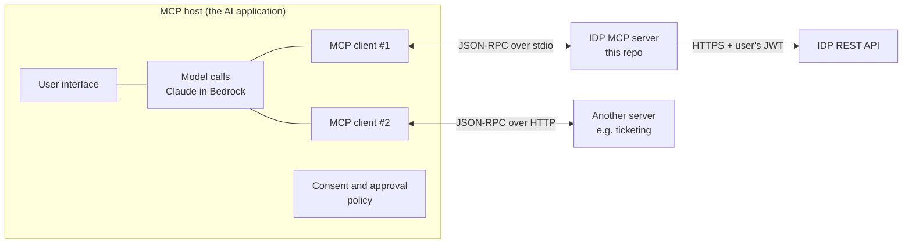

# MCP in this project

The Model Context Protocol (MCP) is an open protocol for connecting AI applications to tools and data.
It is JSON-RPC 2.0 over a transport, with a defined set of roles and primitives. This project implements
an MCP **server** for the document platform and a minimal MCP **host** that uses it.

## 1. Roles: host, client, server



| Role | What it is | In this repo |
|---|---|---|
| **Host** | The application the user interacts with. It owns the conversation, calls the model, decides which tool calls run, and asks for consent. | `src/idp/host/chat_host.py`, or Claude Desktop / Claude Code |
| **Client** | A connector inside the host, **one per server connection**. It runs the protocol handshake, lists capabilities, sends requests, and handles server-initiated requests (elicitation, sampling, roots). | `mcp.Client(...)` in `chat_host.py` |
| **Server** | A program that exposes capabilities (tools, resources, prompts). It doesn't know which model is on the other side. | `src/idp/mcp_server/server.py` |

The model never talks to the server directly. It produces `tool_use` blocks, and the **host** decides
whether to execute them through the **client**.

## 2. Primitives

Server-side primitives, by who controls them:

| Primitive | Controlled by | Here |
|---|---|---|
| **Tools** | The **model** chooses to call them | `search_documents`, `ask_documents`, `get_document`, `get_extracted_fields`, `list_review_queue`, `submit_review` |
| **Resources** | The **application/user** picks what to attach as context | `idp://documents/{document_id}`, `idp://schemas/{doc_type}` (URI templates) |
| **Prompts** | The **user** invokes them (often as slash commands) | `contract_risk_review(document_id)`, `invoice_exception_triage()` |

Client-side features the server can request:

| Feature | Purpose | Here |
|---|---|---|
| **Elicitation** | The server asks the *user* a structured question | `submit_review` asks "Confirm: APPROVE document X?" before running |
| **Sampling** | The server asks the host's model for a completion | Not used. The server has no model access, by design. |
| **Roots** | The host tells the server which filesystem/URI scopes it may use | Not applicable |

**Tool annotations** are hints to the host: `read_only_hint`, `destructive_hint`, `idempotent_hint`,
`open_world_hint`. The host in this repo runs read-only tools without asking and asks the user before
anything else. Annotations come from the server, so a host should only rely on them for servers it trusts.
That's why the REST API enforces permissions again regardless.

## 3. Lifecycle and messages

1. **Connect.** The host starts the server (stdio) or opens an HTTP connection.
2. **Negotiate.** The client and server agree on a protocol version and exchange capabilities (for example,
   the client declares `elicitation`). In SDK 2.x, `Client(mode="auto")` probes `server/discover` and falls
   back to the classic `initialize` handshake.
3. **Discover.** `tools/list`, `resources/templates/list`, `prompts/list`.
4. **Operate.** `tools/call`, `resources/read`, `prompts/get`, plus server-to-client requests such as elicitation.

Example `tools/call` exchange:

```json
→ {"jsonrpc":"2.0","id":7,"method":"tools/call",
   "params":{"name":"search_documents","arguments":{"query":"auto-renewal notice","k":3}}}
← {"jsonrpc":"2.0","id":7,"result":{"content":[{"type":"text","text":"{\"hits\":[...]}"}],"isError":false}}
```

Tool failures come back as results with `isError: true`, so the model can see them and adjust. Protocol
failures, such as a client that can't do elicitation, are JSON-RPC errors.

**Elicitation in SDK 2.x.** `submit_review` declares a parameter filled by a **resolver**
(`Annotated[ElicitationResult[Confirm], Resolve(ask_for_confirmation)]`). On protocol versions from
2026-07-28 on, the question goes back to the client inside an `InputRequiredResult`, and the call resumes
when the client retries with the answer. That design works over stateless HTTP. On older versions, the SDK
sends a standalone `elicitation/create` request in the middle of the call. A client that never declared
elicitation gets a protocol error, so the write can't run unconfirmed.

## 4. Transports

| Transport | When | How it's used here |
|---|---|---|
| **stdio** | Local: the host launches the server as a subprocess and talks over stdin/stdout | `idp-mcp`; token from `IDP_API_TOKEN` |
| **Streamable HTTP** | Remote, shared, many users | `MCP_TRANSPORT=streamable-http idp-mcp`; `stateless_http=True`, `json_response=True` so any replica can serve any request; each request's `Authorization: Bearer` token is forwarded to the API |

To host the HTTP server in production, run it on ECS Fargate or Lambda behind an ALB or API Gateway with TLS.
Put OAuth in front of it: the MCP authorization spec uses OAuth 2.1, and Cognito can be the authorization
server.

## 5. Security model

- **The server is a thin facade over the REST API.** It has no AWS credentials and no direct access to
  S3, DynamoDB, or OpenSearch. Every call carries the end user's token, and API Gateway plus the API's
  ACL checks decide what comes back. That prevents a *confused deputy*, where a privileged server acts for
  a less-privileged user.
- **Token passthrough caveat.** Forwarding the user's Cognito token is simple and keeps a single
  authorization path. A stricter production setup would have the MCP server accept tokens issued *for the
  MCP server* (audience-bound) and exchange them for API tokens (OAuth token exchange), so a token
  minted for one service can't be replayed at another.
- **Untrusted output.** Tool results contain document text. The server's `instructions` and the host's
  system prompt both say to treat it as data. That alone isn't a defense, so the real controls are:
  1. Write tools need explicit human confirmation (elicitation on the server, an approval gate on the host).
  2. The API independently enforces the reviewer role and segregation of duties.
  3. Search results only include documents the user can already read.
- **Tool poisoning / rug pulls.** Hosts should only connect to trusted servers. Tool descriptions are part
  of the model's context, and a malicious server could put instructions in them. Pin server versions and
  review tool lists.
- **Error hygiene.** Deliberate `ToolError`s ("404: document not found") reach the model. Unexpected
  exceptions are reported only as "Error executing tool X", and the details stay in server logs.

## 6. Using it

**Claude Code**

```bash
claude mcp add idp --env IDP_API_URL=https://.../v1 --env IDP_API_TOKEN=$TOKEN -- idp-mcp
```

**Claude Desktop**: add the block in [`mcp/claude_desktop_config.json`](mcp/claude_desktop_config.json).

**The custom host**

```bash
AWS_REGION=us-east-1 IDP_API_URL=... IDP_API_TOKEN=... idp-host
you> Which contracts auto-renew in the next 90 days, and what notice do we need to give?
```

The host lists the server's tools, converts them to Claude tool definitions, and runs the
model→tool→model loop (up to 12 rounds per turn, all results for a turn returned in one message, the full
assistant content appended each turn). It asks you before any non-read-only tool.

## 7. Tests that prove the behavior

`tests/test_mcp_server.py` connects a real MCP client to the server in-process. The server's HTTP calls go
through an `httpx.MockTransport` into the real API handler, with claims mapped from bearer tokens. The tests show:

- Every tool, resource template, and prompt is listed with the right annotations.
- The same `search_documents` call returns hits for a finance user and nothing for a legal-only user.
- API 404s become `isError` tool results.
- `submit_review` fails without elicitation support, does nothing when declined, and approves when accepted.

`tests/test_host.py` covers the host loop: read-only tools run without asking, write tools are blocked
when the user declines, and refusals are handled.
